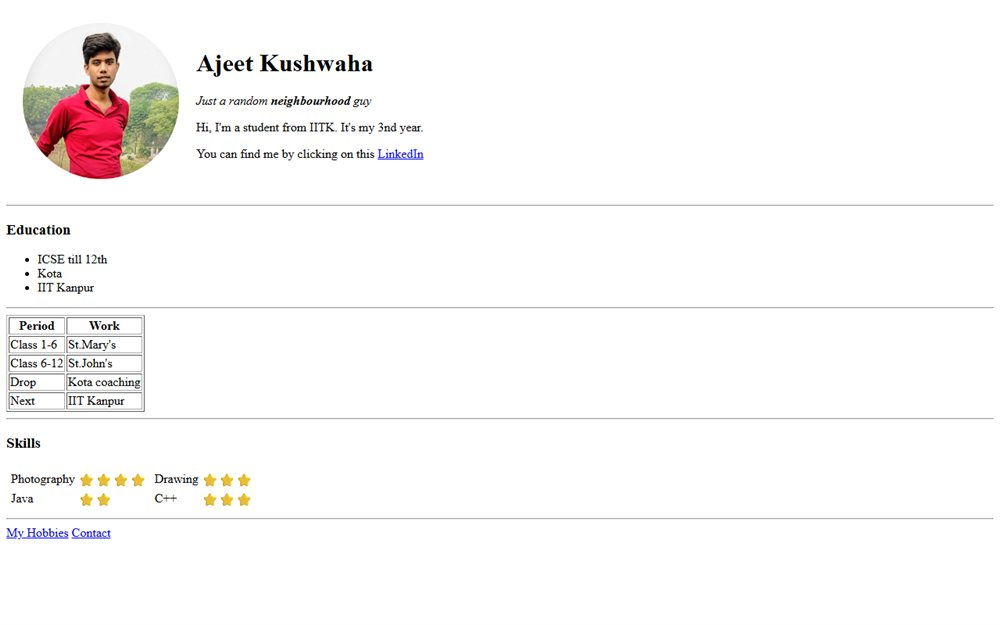

# First_Repository

**[Open the live site](https://ajeet-iitk.github.io/First_Repository/)**

## What it is

The first site I ever pushed to GitHub, kept exactly as it was: a personal homepage with a short introduction, a hobbies page, a contact page, and a couple of form experiments. It is rough in the way a first repo should be - and it still runs.

## Pages

| File | Purpose |
| --- | --- |
| `index.html` | Home page |
| `Hobbies.html` | Things I was into at the time |
| `contact.html` | Contact page |
| `inputexample.html` | Form input experiment |
| `test1.html` | Scratch page |

## Run locally

Open `index.html` in a browser, or use the hosted copy:

<https://ajeet-iitk.github.io/First_Repository/>

## Note

Kept for history rather than maintenance - later projects live in their own repositories.
